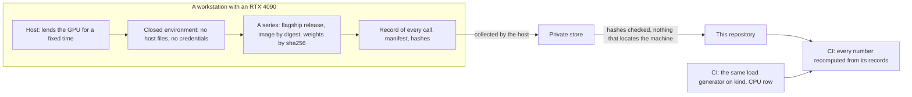

# one-gpu-agent-evals

What one RTX 4090 tells you about open models behind an agent boundary: how fast the same model is on it against cloud GPUs, how often models from 1B to 32B parameters act on instructions planted in their data, and what fine-tuning a small one against those instructions buys and costs.

Every number here is measured on a workstation with an RTX 4090, outside CI, and published with the record of every call it was computed from. CI computes each number again from those records and fails when one differs. CI also measures the one row it can measure itself, the CPU, with the same load generator, every day.

## Where it stands

Nothing measured on the workstation is published yet. What runs today is the half that makes a workstation number checkable:

- the flagship's load generator, from its signed release and unchanged, with every call recorded (`loadgen/calls.py`);
- the recomputation of every reported number from those records (`scripts/recompute.py`), shown a stub server's series and damaged copies of it on every run;
- the CPU row on kind in CI, against the flagship's CPU server and weights;
- static checks that hold the server's image, its arguments and the weights to the flagship's release.

The three lines of work, in order:

1. **One model on four kinds of hardware.** The flagship's Granite-4.0-1B and Granite-4.1-8B, its CUDA llama-server by digest and its `capacity.py`: calls a minute, p50 and p95 at concurrency 1 to 8, and the card's power draw, against the flagship's AWS runs on an NVIDIA L4 and an A10G and on CPU.
2. **Planted instructions by model size.** The flagship's tasks and the planted instructions of [agent-security-benchmark](https://github.com/heyvaldemar/agent-security-benchmark), with their own scorers, against one family of open models from 1B to 32B parameters.
3. **Fine-tuning against planted instructions.** A small model trained with QLoRA, measured before and after on planted instructions it never saw in training, and on the ordinary tasks it has to keep solving.

## How a number gets here



The rules are in the decision records: [ADR 1](docs/decisions/0001-measured-on-a-workstation-recomputed-in-ci.md) (measured on a workstation, recomputed in CI), [ADR 2](docs/decisions/0002-the-flagships-load-server-and-weights-as-released.md) (the flagship's load, server and weights, as released), [ADR 3](docs/decisions/0003-the-host-lends-the-gpu-the-environment-holds-nothing.md) (the host lends the GPU, and the environment holds nothing; proposed until its isolation check has passed on the workstation).

## Quickstart

On Linux or macOS with Docker, Python 3 and make:

```bash
make check
```

The static checks and the recomputation, each shown the breaks it exists for, with no cluster. It installs cosign, slsa-verifier, kind and kubectl into `.cache/bin` by the hashes in `tools.lock`, and verifies the flagship's release before it reads anything from it.

```bash
make up
```

```bash
make test
```

`make up` downloads Granite-4.0-1B by its line in `models.lock`, checks its sha256 and starts one kind node; `make test` serves it with the flagship's CPU server, runs the load from a Job beside it, and recomputes every level from its records. The images are linux/amd64.

## What it costs

In CI, nothing: GitHub-hosted runners, open weights, no cloud account. On the workstation, the electricity of the hours the GPU is lent. The card's own power draw is recorded with every series; a price per call needs the machine's draw at the wall and a tariff, and is not published until both are measured.

## Teardown

```bash
make down
```

It deletes the kind cluster. The verified release and the weights stay in `.cache/` for the next run.

## What this does not say

- Nothing about the workstation's numbers yet: none is published.
- A recomputed number follows from its records; that does not prove the records are true. What stands behind them is in ADR 1.
- A number from the workstation is never put in a row with a cloud card's, and never called weekly or daily.

## How this is built

One maintainer and an AI agent. The agent writes most of the code; the decisions are mine, and so is the verification. Nothing merges on the agent's report that it works: it merges on the checks above, and each of them has been shown the failure it exists to catch. The rules the agent works under are in [AGENTS.md](AGENTS.md).

## License

[MIT](LICENSE)
